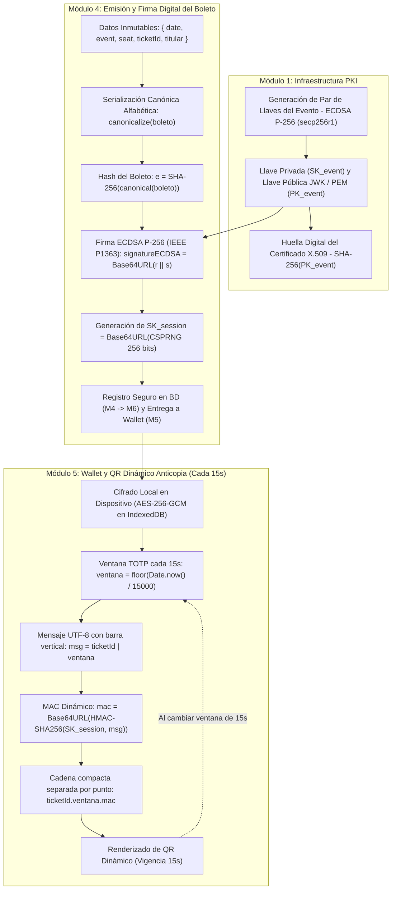
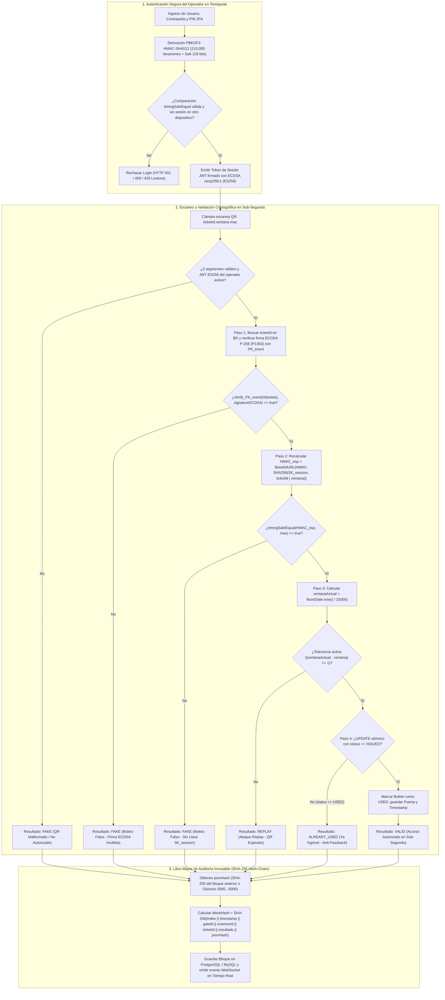

# Módulo 6: Control de Acceso en Puertas (Validator App) y Registro de Auditoría

Implementación del **Módulo 6** con **Backend en Node.js** y **App Móvil en Expo (React Native)** con diseño minimalista inspirado en **Ticketmaster (`SafeTix™`)**, 100% integrada con el formato de Wallet y QR Dinámico del **Módulo 5** (`ticketId.ventana.mac` + `Web Crypto API`).

---

## 📦 Contrato Oficial del QR Dinámico y Boleto (Módulos 4 y 5 ➔ Módulo 6)

### 1. Texto Exacto Codificado en el QR Dinámico (`ticketId.ventana.mac`)

La **Wallet (Módulo 5)** codifica en el código QR una cadena compacta de texto plano con **3 segmentos separados por punto literal (`.`)**, que rota cada **15 segundos**:

```text
BOL-001.119674540.9f86d081884c7d659a2feaa0c55ad015a3bf4f1b2b0
```

| Segmento | Tipo | Origen | Regla de Construcción |
| :--- | :--- | :--- | :--- |
| **`ticketId`** | `string` | Módulo 4 | Identificador único del boleto sin puntos `.` (ej. `BOL-001` o `TKT-2026-0001`). |
| **`ventana`** | `integer` | Módulo 5 | Escalón temporal decimal de 15s: `Math.floor(Date.now() / 15000)`. |
| **`mac`** | `Base64URL` | Módulo 5 | `Base64URL(HMAC-SHA256(SK_session, UTF-8(ticketId + "|" + ventana)))` sin relleno `=`. |

> **Compatibilidad Dual**: El validador de Módulo 6 ([`parseQrInput`](file:///c:/Users/chang/OneDrive/Documentos/STC/Proyecto/backend/src/validatorService.js#L114-L165)) acepta de forma nativa `ticketId.ventana.mac` como formato principal y mantiene soporte retrocompatible para contenedores JSON `QrEnvelope`.

---

### 2. Estructura JSON de la Wallet y Firma Digital ECDSA (`P-256` / `IEEE P1363`)

El Módulo 6 expone y sincroniza la estructura exacta utilizada por la Wallet del Módulo 5 en `GET /api/wallet/export` y `POST /api/wallet/sync`:

```json
{
  "tickets": [
    {
      "ticketId": "BOL-001",
      "event": "Concierto Magistral Cripto-Sinfónico 2026",
      "date": "15/11/2026",
      "seat": "A12",
      "titular": "Usuario de prueba (Módulo 5)",
      "status": "ACTIVO",
      "skSession": "CLAVE_256_BITS_EN_BASE64URL",
      "signatureECDSA": "FIRMA_64_BYTES_IEEE_P1363_EN_BASE64URL"
    }
  ],
  "publicKeyJwk": {
    "kty": "EC",
    "crv": "P-256",
    "x": "COORDENADA_X_BASE64URL",
    "y": "COORDENADA_Y_BASE64URL"
  }
}
```

#### Reglas Criptográficas Compartidas (`cripto.js` en M5 ↔ `cryptoEngine.js` en M6)
1. **Canonización (`canonicalize`)**: Se ordenan alfabéticamente las llaves con `Object.keys(obj).sort()` firmando **únicamente los campos inmutables del boleto**: `{ date, event, seat, ticketId, titular }` (excluyendo `skSession`, `signatureECDSA` y `status`).
2. **Formato de Firma ECDSA**: Curva **`P-256` (`secp256r1`)** con **`SHA-256`** en codificación **`IEEE P1363`** (`r || s`, 64 bytes en `Base64URL` sin `=`), 100% compatible entre `crypto.subtle` (navegador) y `crypto` (`dsaEncoding: 'ieee-p1363'` en Node.js).
3. **Cálculo de MAC cada 15s**:
   - En el mensaje autenticado el separador es **barra vertical (`|`)**: `` `${ticketId}|${ventana}` ``.
   - En el texto del QR el separador es **punto (`.`)**: `` `${ticketId}.${ventana}.${mac}` ``.

---

## 🤝 Respuestas Oficiales del Módulo 6 a las Preguntas del Equipo de Módulo 5

Esta sección responde punto por punto al documento **`CONTRATO PROVISIONAL DE QR DINÁMICO — MÓDULO 5 HACIA MÓDULO 6`**:

### 1. ¿El Módulo 6 acepta tal cual `ticketId.ventana.mac` y la tolerancia `±1` ventana?
- **Sí, confirmado al 100%**. El validador de Módulo 6 procesa directamente la cadena de texto `ticketId.ventana.mac` (exigiendo exactamente 3 componentes separados por `.`), mensaje UTF-8 `ticketId|ventana`, clave y MAC en `Base64URL` sin relleno `=`, `QR_WINDOW_MS = 15000` y **tolerancia definitiva de `±1` ventana** (`Math.abs(ventanaActual - ventanaRecibida) <= 1`).
- **Restricción acordada**: El `ticketId` emitido por M4 debe coincidir con `^[A-Za-z0-9_-]+$` (nunca contener puntos `.`).

### 2. ¿Cómo obtiene el Módulo 6 de manera segura la `SK_session` asociada al `ticketId`?
- `SK_session` **jamás se incluye en el QR ni se expone en endpoints públicos**.
- **Flujo M4 ➔ BD ➔ M6**: Cuando el **Módulo 4 (Ticket Engine)** emite un boleto tras confirmar el pago, almacena el registro del boleto (`ticketId`, payload canónico, `signatureECDSA` y `SK_session` de 256 bits) en la base de datos transaccional compartida (**PostgreSQL / MySQL**) o lo sincroniza con M6 mediante canal interno autenticado.
- Cuando la cámara en puerta lee `ticketId.ventana.mac`, el backend de M6 recupera internamente `SK_session` por `ticketId` para recalcular `HMAC-SHA256` y compararlo con `crypto.timingSafeEqual`.
- *(Para pruebas de integración directa con el prototipo local de M5, habilitamos `GET /api/wallet/export` y `POST /api/wallet/sync`)*.

### 3. ¿Cómo comprueba el Módulo 6 que el boleto es auténtico, está activo y no fue cancelado?
En cada escaneo (`POST /api/access/validate`), M6 ejecuta en sub-segundo (~`0.8 ms`):
1. **Existencia y vigencia administrativa**: Busca `ticketId` en la base de datos y verifica que no esté en estado `REVOKED` / `CANCELADO`.
2. **Autenticidad criptográfica (`ECDSA P-256`)**: Reconstruye el JSON canónico de los campos inmutables del boleto y ejecuta `Verify_PK_event(SHA-256(canonical(boleto)), signatureECDSA)` en formato `IEEE P1363` contra la llave pública de la PKI (`PK_event`). Si el registro fue alterado en almacenamiento o la firma no corresponde a la CA del evento, responde `FAKE`.

### 4. ¿Cómo impide utilizar el mismo boleto más de una vez y cómo maneja escaneos simultáneos?
- **Control Anti-Passback Atómico**: La transición de entrada en PostgreSQL/MySQL se ejecuta con una sentencia atómica condicional a nivel de fila ([`markTicketUsedAtomic`](file:///c:/Users/chang/OneDrive/Documentos/STC/Proyecto/backend/src/db.js#L502-L545)):
  ```sql
  UPDATE tickets
  SET status = 'USED', used_at = $2, used_gate = $3, last_totp_step = $4
  WHERE ticket_id = $1 AND status = 'ISSUED'
  RETURNING ticket_id;
  ```
- Si dos torniquetes escanean el mismo QR exactamente en el mismo milisegundo, el bloqueo de fila del motor SQL garantiza que **solo una petición obtenga `1 fila afectada` (`VALID`)**, mientras que la segunda obtiene `0 filas afectadas` y devuelve inmediatamente **`ALREADY_USED`** indicando la puerta y hora exacta del primer acceso.
- Además, cada lectura (válida o rechazada) queda sellada en el **Libro Mayor de Auditoría (`audit_ledger`)** mediante una cadena inmutable de hashes **`SHA-256` (`Hash-Chain`)**.

### 5. ¿Cómo sincroniza los relojes y cómo valida el acceso si falla la conexión?
- **Sincronización temporal**: El servidor de M6 sincroniza su reloj mediante **NTP** y expone `serverTime` en `GET /api/health`. La ventana de `15s` con tolerancia `±1` absorbe desfases de hasta `±15–30s` en los teléfonos de los asistentes.
- **Operación ante fallos de Internet externo**: Los lectores móviles (App Expo) y el servidor de M6 operan dentro de la **red local (LAN Wi-Fi) del auditorio**, por lo que una caída del proveedor de Internet externo no detiene los torniquetes. Adicionalmente, M6 cuenta con espejo transaccional local sincronizado en caso de interrupción temporal del motor SQL, y la llave pública `publicKeyJwk` es cacheable para verificación offline de firma ECDSA.

### 6. Especificación de la API de Validación del Módulo 6
*(Nota: La Wallet de M5 solo renderiza el QR en pantalla; quien consume esta API es la App Escáner del Módulo 6)*:

- **Llave Pública PKI (JWK y PEM)**: `GET /api/pki/public-key`
- **Login de Operador de Torniquete**: `POST /api/auth/login` (`PBKDF2-HMAC-SHA512` 210k iter + PIN 2FA + Sesión Única por Dispositivo ➔ `Bearer JWT ES256`).
- **Validación de QR en Puerta**: `POST /api/access/validate`
  - **Solicitud (`Request`)**:
    ```json
    {
      "qrData": "BOL-001.119674540.9f86d081884c7d659a2feaa0c55ad015a3bf4f1b2b0",
      "gateId": "PUERTA-NORTE-01",
      "scannerId": "IPHONE-IOS-A1B2"
    }
    ```
  - **Respuesta (`Response 200 OK`)**:
    Devuelve `status` en uno de 4 estados: `"VALID"` | `"REPLAY"` | `"FAKE"` | `"ALREADY_USED"`, junto con `latencyMs`, `cryptoChecks` (`ecdsaVerified`, `hmacVerified`, `totpWindowValid`), información de asiento y el bloque sellado `auditBlock` (`prevHash` y `blockHash`).

---

## 📊 Diagramas de Flujo Criptográficos (Mermaid)

### 1. Flujo de Emisión del Boleto y Creación del QR Dinámico (Módulos 1, 4 y 5)



### 2. Flujo del Lector / Validador de QR y Libro Mayor de Auditoría (Módulo 6)



---

## 🎤 Guión de Exposición Paso a Paso del Diagrama Criptográfico (`diagrama_lectura_qr.html`)

Este guión está estructurado siguiendo exactamente el recorrido visual de izquierda a derecha del archivo [`diagrama_lectura_qr.html`](file:///c:/Users/chang/OneDrive/Documentos/STC/Proyecto/diagrama_lectura_qr.html) (donde los **óvalos** representan algoritmos/ecuaciones criptográficas, las **tolvas** representan funciones hash generadoras de digestos, los **rombos** decisiones y los **cilindros** consultas a base de datos).

---

### 🔹 Parte 1: Receptor, Inicio de Sesión y Lectura Inicial (Arriba a la Izquierda)

> **1. Inicio de sesión del operador (`[Inicia Sesión]` ➔ `Óvalo PBKDF2-SHA512 + JWT ES256`)**
> *"El flujo comienza en el **Receptor**, que es la aplicación escáner en el torniquete o celular del personal de acceso. Antes de poder activar la cámara, el operador debe autenticarse ingresando su identificador, contraseña y un PIN de seguridad de segundo factor (2FA).*
> *Estas credenciales pasan al **primer óvalo criptográfico**, donde se deriva la llave con **PBKDF2-HMAC-SHA512 aplicando 210,000 iteraciones y un salt único de 128 bits**, comparándola en tiempo constante (`timingSafeEqual`). Además, se valida que el operador no tenga una sesión activa en otro dispositivo y la PKI emite un **token de sesión JWT firmado con ECDSA en la curva `secp256r1` (`ES256`)** con un identificador único `JTI`."*

> **2. Escaneo óptico y validación estructural (`[QR Escanea]` ➔ `Rombo ¿Formato válido y JWT del escáner?`)**
> *"Una vez autenticado, el lector escanea el código QR dinámico generado por la Wallet del Módulo 5 con la estructura `ticketId.ventana.mac`.*
> *En el **primer rombo** verificamos que el JWT del escáner sea válido y que la cadena del QR tenga exactamente sus 3 segmentos bien formados. Si está corrupto, sale por la rama **Inválido** como **QR mal formado (`FAKE`)** y termina el flujo. Si es **Válido**, pasamos a la verificación de firma digital."*

---

### 🔹 Parte 2: Verificación de Firma Digital con Tolva `SHA-256` y Curva Elíptica `ECDSA` (Abajo a la Izquierda)

> **3. Las 3 entradas que convergen en el Óvalo de la Ecuación Elíptica ECDSA**
> *"Para comprobar en menos de un milisegundo que el boleto fue emitido por la boletera oficial y que nadie alteró el asiento o titular, preparamos **tres entradas** que convergen en el **óvalo de la Ecuación Elíptica ECDSA (`P-256` / `secp256r1`)**:*
> 1. **Rama izquierda (La Firma)**: *Tomamos la firma `signatureECDSA` en formato `IEEE P1363` (`Base64URL`) y extraemos el **par de enteros $(r, s)$** de 256 bits.*
> 2. **Rama central (La Tolva `SHA-256`)**: *Tomamos los campos inmutables del boleto ordenados alfabéticamente (`canonicalize`) y los introducimos por la boca de la **Tolva `SHA-256`**. Por la boquilla inferior sale el **digesto $e = H(\text{boleto})$ de 256 bits**.*
> 3. **Rama inferior (El Cilindro `BD PKI`)**: *Consultamos la **Llave Pública del evento (`PK_event`)** en la curva `P-256`."*

> **4. Evaluación de la Ecuación Elíptica y Rombo de Coordenada (`Óvalo ECDSA` ➔ `Rombo ¿x1 == r (mod n)?`)**
> *"Estas tres flechas (`par (r,s)`, `digesto e` y `llave pública PK_event`) entran al **óvalo de la Ecuación Elíptica ECDSA**, que calcula el punto $(x_1, y_1) = u_1 \cdot G + u_2 \cdot PK_{\text{event}}$.*
> *El resultado baja al **segundo rombo**: **¿La coordenada $x_1$ es congruente con $r \pmod n$?***
> - *Si es **No**, sale hacia la izquierda como **Boleto Falso (`FAKE`)**.*
> - *Si es **Sí**, queda demostrado matemáticamente que es un **Boleto Auténtico**, y seguimos la línea conectora hacia la columna derecha para validar el tiempo y evitar capturas de pantalla."*

---

### 🔹 Parte 3: Validación Dinámica con Tolva `HMAC-SHA256` y Ventana de 15 Segundos (Columna Derecha)

> **5. Recálculo del HMAC con Tolva (`[Obtener ventana y MAC]` ➔ `Tolva HMAC-SHA256` ➔ `Óvalo timingSafeEqual`)**
> *"En la columna derecha tomamos la `ventana` y el `mac` leídos del QR. Hacemos entrar a la **Tolva `HMAC-SHA256`** dos elementos: el mensaje `ticketId|ventana` y la llave secreta **`SK_session`** obtenida internamente del **cilindro `BD (Boleto)`**.*
> *De la tolva sale el MAC esperado en `Base64URL` hacia el **óvalo de comparación en tiempo constante (`timingSafeEqual`)**.*
> *En el **tercer rombo (`¿Se creó con la Wallet?`)**: si los MAC no coinciden, el emisor no posee `SK_session` y se rechaza a la derecha como **Boleto Falso (`FAKE - Sin llave SK_session`)**."*

> **6. Verificación de la Ventana Temporal de 15 Segundos (`Óvalo TOTP 15s` ➔ `Rombo ¿Entra en tiempo?`)**
> *"Si el MAC coincide, bajamos al **óvalo de ventana TOTP (15s)**, donde el servidor calcula su ventana actual $T_{\text{now}} = \lfloor \text{now} / 15000 \rfloor$.*
> *En el **cuarto rombo (`¿Entra en tiempo 15s?`)** comprobamos con tolerancia `±1` que $|T_{\text{now}} - \text{ventana}| \le 1$.*
> - *Si es **No** (captura de pantalla antigua), se bloquea hacia la derecha como **Ataque Replay (`REPLAY - QR Expirado`)**.*
> - *Si es **Sí**, el QR fue generado en vivo."*

---

### 🔹 Parte 4: Control Anti-Passback y Tolva del Libro Mayor `Hash-Chain` (Abajo a la Derecha)

> **7. Verificación de Ingreso Único y Cadena de Hashes (`Rombo ¿Primer ingreso?` ➔ `Tolva SHA-256 Hash-Chain`)**
> *"Finalmente, en el **quinto rombo (`¿Primer ingreso? status == ISSUED`)**, se ejecuta un `UPDATE` atómico en la base de datos:*
> - *Si ya estaba en `USED`, responde **Ya Ingresó (`ALREADY_USED`)** mostrando la puerta y hora previa.*
> - *Si estaba en `ISSUED`, responde **Boleto Válido (`VALID`)** en sub-segundo y marca la entrada.*
> *Todo intento pasa por la **tercera Tolva `SHA-256`**, que concatena el bloque actual con `prevHash` para sellar el nuevo `blockHash` en el **cilindro `BD Auditoría` (Hash-Chain)**."*

---

## 📄 Contrato OpenAPI 3.0

- Archivo local: [`backend/openapi.yaml`](file:///c:/Users/chang/OneDrive/Documentos/STC/Proyecto/backend/openapi.yaml)
- Endpoint en vivo: `GET http://localhost:4000/api/openapi.yaml`

---

## 🚀 Cómo Ejecutar el Proyecto

### 1. Iniciar el Backend (Node.js)
```bash
cd backend
npm install
npm start
```

### 2. Iniciar la App Móvil (Expo) en tu iPhone o Android
```bash
cd mobile-validator
npx expo start
```
